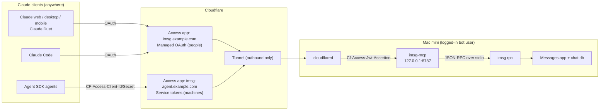

# imsg-mcp

An [MCP](https://modelcontextprotocol.io) server that lets AI assistants read and send your iMessage and SMS texts through a Mac you control, with guardrails the model cannot talk its way around.

Point Claude (on the web, desktop or phone), Claude Code, [Claude Duet](https://claude.com/product/claude-duet) or an Agent SDK agent at it, and the assistant can list your chats, read history, catch up on what arrived since it last looked, search, and (only if you turn it on) send texts from your number.

```
You: "What are my latest texts?"
Claude → check_new_messages → "Sam says he's running 10 min late. Your mom sent a photo from the trip."

You: "Tell Sam no rush."
Claude → "I'll send 'No rush!' to Sam (+1 415 555 0123). OK?"  → you approve → send_message
```

`imsg-mcp` is a thin TypeScript server on top of [`imsg`](https://github.com/steipete/imsg), which does the actual Messages work. It adds the MCP tools, authentication, a send fence, an audit log, and the plumbing to run unattended on a Mac mini.

> [!WARNING]
> Anyone can text your number, and no server can stop a model from being influenced by a malicious message. That is why sending is **off by default**, limited to an **allowlist** checked on the server, **rate limited**, **audited**, and should always require **your approval** in the client. Read [docs/security.md](docs/security.md) before you turn sending on.

## Features

- **Six tools:** `list_chats`, `get_messages`, `check_new_messages`, `search_messages`, `get_status`, and `send_message` (registered only when sending is enabled).
- **Cursor-based catch-up.** A watch stream stores inbound texts locally, so an agent can ask "what's new since cursor N?" and nothing is lost across restarts.
- **Fenced sending.** Off by default; recipient allowlist (every member of a group must be allowed); length limit; sliding-window rate limit shared by all clients; sends confirmed against Messages history; before-and-after audit records.
- **Prompt-injection hygiene.** Every result that contains third-party text is flagged `untrusted_content` with a note telling the model to treat it as data.
- **Read scope.** Limit what the assistant can see to specific chats or people.
- **Two ways to run:**
  - **Remote mode** (the main design): a private server on an always-on Mac, reachable from every Claude surface through Cloudflare Tunnel, with Cloudflare Access doing OAuth sign-in. No open ports.
  - **Local mode**: `imsg-mcp stdio` for Claude Desktop or Claude Code on the same Mac. No network at all.
- **Built for unattended operation:** one signed binary, a launchd agent, automatic restarts with backoff, health endpoint, outbound heartbeat for a dead-man's switch, rotated logs, and a self-test.

## How it works



Cloudflare Access authenticates every request and attaches a signed JWT. `imsg-mcp` verifies that JWT itself (signature, audience, issuer, expiry) before doing anything, maps the caller to a role, and serves MCP over Streamable HTTP in stateless mode. All Messages access goes through one long-lived `imsg rpc` child process. Details: [docs/architecture.md](docs/architecture.md).

## Requirements

- macOS 14 or later, signed in to Messages (an always-on Mac mini for remote mode).
- [`imsg`](https://github.com/steipete/imsg) 0.8.2 or later: `brew install steipete/tap/imsg`. Newer versions are used automatically when present (for example, `messages.search` makes `search_messages` faster).
- [Bun](https://bun.sh) 1.2 or later to build (the shipped binary needs nothing installed).
- Remote mode only: a Cloudflare account with a domain and Zero Trust.

## Quick start: local mode (your own Mac, 5 minutes)

Local mode is the fastest way to try it: the client starts `imsg-mcp` over stdio, so there is no network listener and no Cloudflare.

```bash
git clone https://github.com/project-nomos/imsg-mcp.git
cd imsg-mcp
bun install
scripts/build.sh            # produces dist/imsg-mcp
dist/imsg-mcp init          # writes ~/Library/Application Support/imsg-mcp/config.toml (mode 0600)
dist/imsg-mcp check-config
```

Add it to Claude Code:

```bash
claude mcp add --scope user imessage -- "$PWD/dist/imsg-mcp" stdio
```

Or to Claude Desktop (`~/Library/Application Support/Claude/claude_desktop_config.json`):

```json
{
  "mcpServers": {
    "imessage": { "command": "/absolute/path/to/dist/imsg-mcp", "args": ["stdio"] }
  }
}
```

macOS only lets apps with **Full Disk Access** read `~/Library/Messages/chat.db`. In local mode the permission check applies to the app that launched the server (Claude Desktop, or your terminal for Claude Code), so grant Full Disk Access to that app. Sending also needs **Automation → Messages** (macOS asks on the first send). See [docs/clients.md](docs/clients.md#local-mode-stdio).

Sending stays off until you edit the config:

```toml
[send]
enabled = true
allowlist = ["+14155550123", "friend@example.com"]
```

## Full setup: remote mode on a Mac mini

This is the deployment the project is designed around: a dedicated Mac that keeps Messages open around the clock and serves every Claude surface, from your phone on cellular to headless agents.

1. **Prepare the Mac**: a standard bot user with automatic login, Messages signed in, SMS forwarding, power settings. [docs/mac-mini-setup.md](docs/mac-mini-setup.md)
2. **Build, sign and install** the binary with a stable code-signing identity so macOS privacy grants survive updates, then grant Full Disk Access and Automation to it. [docs/mac-mini-setup.md](docs/mac-mini-setup.md#4-build-and-install)
3. **Set up Cloudflare**: one outbound tunnel, two Access applications (people with Managed OAuth, machines with service tokens). [docs/cloudflare.md](docs/cloudflare.md)
4. **Connect your clients**: Claude custom connector, Claude Code, Agent SDK. [docs/clients.md](docs/clients.md)
5. **Run the acceptance checklist** before turning sending on. [docs/testing.md](docs/testing.md#acceptance-checklist)

## Tools

| Tool                 | What it does                                                                   | Notes                                                                 |
| -------------------- | ------------------------------------------------------------------------------ | --------------------------------------------------------------------- |
| `list_chats`         | Recent conversations, optionally filtered by name, number or email             | `query?`, `limit?` (20, max 100)                                      |
| `get_messages`       | History of one chat, oldest to newest, with `prev_cursor` for paging back      | `chat_id`, `limit?` (30, max 200), `before_cursor?`, `start?`, `end?` |
| `check_new_messages` | Inbound texts after a cursor, across all readable chats                        | `since_cursor?` (omit: last 24 h), `chat_id?`, `limit?` (50, max 200) |
| `search_messages`    | Case-insensitive text search, newest first                                     | `query`, `chat_id?`, `start?`, `end?`, `limit?` (20, max 50)          |
| `get_status`         | imsg version, watch health, last inbound time, send settings, rate budget left | no inputs                                                             |
| `send_message`       | Send a text to a phone number, email or existing chat                          | `to` or `chat_id`, `text`. Only exists when `send.enabled = true`     |

Messages come back in one shape:

```json
{
  "cursor": 918233,
  "chat_id": 42,
  "chat_name": "Sam",
  "sender": "+14155550123",
  "sender_name": "Sam",
  "from_me": false,
  "sent_at": "2026-11-13T18:04:11Z",
  "service": "iMessage",
  "text": "Running 10 min late",
  "attachments": [{ "name": "IMG_0412.HEIC", "mime": "image/heic", "bytes": 2104331 }]
}
```

Full reference, including errors and cursor semantics: [docs/tools.md](docs/tools.md).

## Security model in one screen

| Risk                                                     | What stops it                                                                                                                                                               |
| -------------------------------------------------------- | --------------------------------------------------------------------------------------------------------------------------------------------------------------------------- |
| A stranger's text tells the assistant to message someone | Sending off by default; server-side allowlist; client approval on every send; rate limit; `untrusted_content` flags                                                         |
| The assistant texts the wrong person, or floods someone  | Allowlist checked on the server for every send (all group members must be allowed); 1,000-character limit; 10 sends/hour and 40/day by default; every send in the audit log |
| Someone reaches the server without signing in            | No open ports (outbound tunnel only); Cloudflare Access in front; the server binds to loopback and still verifies the Access JWT on every request (`403` otherwise)         |
| A leaked machine token                                   | Service tokens get the `read` role unless you choose otherwise; revoke in the Zero Trust dashboard                                                                          |
| Too much power on the Mac                                | Non-admin bot user; Full Disk Access granted to one signed binary, never to Terminal, `node` or `python3`                                                                   |

More, including the audit log format and kill switches: [docs/security.md](docs/security.md).

## Operations

- `GET http://127.0.0.1:8788/healthz` (loopback only, never tunneled): child process, Messages.app, watch sync, last history call.
- An outbound heartbeat every 5 minutes while healthy, for a dead-man's switch such as Healthchecks.io.
- Logs in `~/Library/Logs/imsg-mcp/`: `server.log` (no message text, 14 days) and `audit.jsonl` (90 days).
- `imsg-mcp selftest --launchd` after every imsg, server or macOS update.
- Kill switches, fastest first: disable the Access app in the Zero Trust dashboard; set `send.enabled = false` and send `SIGHUP`; `launchctl bootout` the agent.

See [docs/operations.md](docs/operations.md) and [docs/troubleshooting.md](docs/troubleshooting.md).

## Command line

```
imsg-mcp [serve]          Serve MCP over HTTP on loopback (behind Cloudflare Tunnel + Access)
imsg-mcp stdio            Serve MCP over stdin/stdout for a local client (no network)
imsg-mcp selftest         Smoke test: read a chat, send to selftest.to, wait for the reply
imsg-mcp check-config     Validate the config and check imsg
imsg-mcp acceptance       Run the automatable acceptance checks against a deployment
imsg-mcp init             Write a starter config (mode 0600)
imsg-mcp version          Print the version
```

## Development

```bash
bun install
bun test              # unit + integration tests (uses a stub imsg; no Mac permissions needed)
bun run typecheck
bun run lint
bun run check         # everything CI runs
bun run src/cli.ts stdio --config ./my-test-config.toml
bun scripts/dev-remote.ts   # remote (HTTP) mode behind a local Access stand-in, demo data
```

The integration tests run the real server against `test/fixtures/stub-imsg.ts`, which speaks imsg's JSON-RPC protocol with payloads in imsg's exact shapes, including watch notifications, send outcomes, child crashes and permission errors. On a Mac with imsg installed, `IMSG_MCP_TEST_REAL_IMSG=1 bun test test/integration/real-imsg.test.ts` runs the server against the **real imsg binary** with a synthetic `chat.db` (no permissions needed, nothing sent); CI does the same with the current Homebrew imsg. See [CONTRIBUTING.md](CONTRIBUTING.md) and [docs/testing.md](docs/testing.md).

## Limitations

- No typing indicators, read receipts, edits, tapbacks or polls: those need imsg's private-API bridge, which requires turning off System Integrity Protection.
- No push: agents poll `check_new_messages` with a cursor.
- No sending attachments. Inbound attachment metadata (name, type, size) is included; file contents never leave the Mac.
- Remote mode is built for a single owner. The Messages API MCP connector is not supported (it sends only a bearer token, not Cloudflare's service-token headers).

## Acknowledgments

[`imsg`](https://github.com/steipete/imsg) by Peter Steinberger and contributors does the hard work of reading `chat.db` and driving Messages. This project would not exist without it.

## License

[MIT](LICENSE). Not affiliated with Apple or Anthropic. iMessage and Messages are trademarks of Apple Inc.
