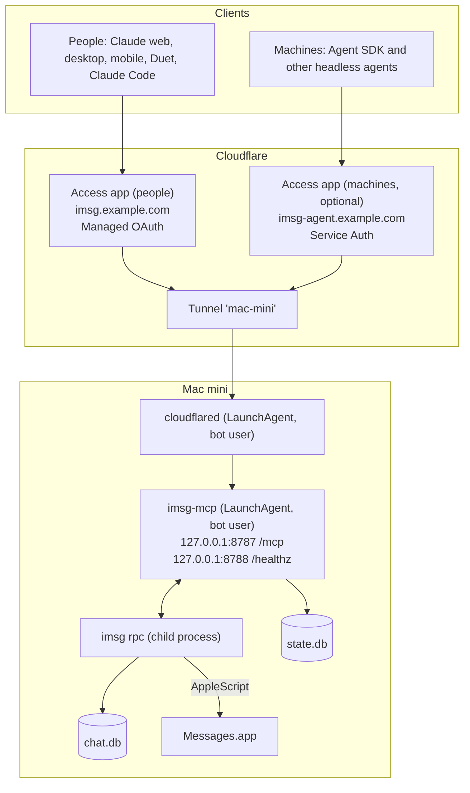

# Architecture

`imsg-mcp` is a private MCP server that lets AI assistants read and send texts through Messages.app on a Mac. [`imsg`](https://github.com/steipete/imsg) does the Messages work; `imsg-mcp` adds the MCP tools, authentication, guardrails and operations. In remote mode, Cloudflare Tunnel exposes it with no open ports and Cloudflare Access handles OAuth sign-in.

## Goals and non-goals

**Goals (v1)**

- Claude on web, desktop and mobile, Claude Code, and Agent SDK agents can list chats, read history, check for new messages and send texts.
- Nothing on the home network accepts inbound connections. All traffic arrives through an outbound Cloudflare Tunnel.
- Every client signs in with OAuth before any tool call. Machine clients use a scoped Cloudflare service token.
- Sending is fenced: off by default, recipient allowlist, approval prompt, rate limit, audit log.
- The Mac recovers on its own from reboots and power loss.

**Non-goals (v1)**

- Features that need imsg's private API (typing indicators, read receipts, edits, polls). They require turning off System Integrity Protection.
- Pushing new messages to the agent. Agents poll with a cursor instead.
- Sending attachments. Inbound attachment metadata is in scope.
- Access for anyone other than the owner.

## The three layers

Only `imsg-mcp` is written here; everything else is installed and configured.

A first call from Claude gets a `401` from Access, which starts sign-in. After that, each call carries a short-lived token. Access checks it and attaches a signed JWT (`Cf-Access-Jwt-Assertion`) before the request travels down the tunnel to the Mac.

## Request path

For every request to `/mcp`:

1. **Authenticate.** Read `Cf-Access-Jwt-Assertion` and verify the RS256 signature against the team's JWKS (`https://<team>.cloudflareaccess.com/cdn-cgi/access/certs`), then check `aud`, `iss`, `exp` and `nbf`. Anything else gets `403`, even though Cloudflare should never forward it. The server trusts nothing else: not the source IP, not a `Host` header, not a forwarded email header.
2. **Authorize.** An `email` claim listed in `access.people` is a person with the `full` role. A `common_name` claim (a service token's client id) listed in `access.service_tokens` is a machine with that token's role (`read` or `read_send`).
3. **Serve MCP.** A fresh MCP server is built for the request with the tools that caller may use (`send_message` only when sending is enabled and the role includes send), and the Streamable HTTP transport handles the JSON-RPC exchange in stateless mode with JSON responses. No MCP sessions are kept.

`GET` and `DELETE` on `/mcp` return `405` because a stateless server has no stream or session to offer.

## Why Cloudflare Access

Remote mode needs three things: a public HTTPS address for a Mac behind a home router, a sign-in that Claude's connectors understand, and a way to keep strangers away from the Mac. Cloudflare covers all three:

- **Tunnel:** an outbound connection from the Mac, so no ports are opened. It works on any plan, free included.
- **Access with Managed OAuth:** Cloudflare runs the OAuth flow that Claude's connectors use against the identity provider you choose, so MFA comes from there. The flow: a `401` pointing at discovery metadata, client registration, PKCE, and short-lived tokens with refresh.
- **Edge enforcement:** requests without a valid sign-in stop at Cloudflare and never reach the Mac. The server still verifies the Access JWT on every request, so a missing or misconfigured Access application fails closed.

The cost is a Zero Trust organization. Its Free plan covers up to 50 users, but it asks for a payment method.

Alternatives considered:

| Option                                   | Why not, for now                                                                                                                                                                                                                                                     |
| ---------------------------------------- | -------------------------------------------------------------------------------------------------------------------------------------------------------------------------------------------------------------------------------------------------------------------- |
| The server as its own OAuth server       | It would remove the Zero Trust account. But every request would reach the Mac, with the server's own login as the only gate, and an OAuth server is security-critical code to maintain. If it is ever added, the login should use passkeys, which cannot be phished. |
| Another tunnel (Tailscale Funnel, ngrok) | Gives the public address but no sign-in Claude understands, so it would need the built-in OAuth server above.                                                                                                                                                        |
| A secret URL and no sign-in              | Simplest, but anyone who ever sees the URL (in a log, a browser history or a screenshot) can read and send your texts.                                                                                                                                               |

## Components

| Module                    | Role                                                                                                                   |
| ------------------------- | ---------------------------------------------------------------------------------------------------------------------- |
| `src/cli.ts`              | Commands: `serve`, `stdio`, `selftest`, `check-config`, `init`, `version`. Signals: `SIGHUP` reloads, `SIGTERM` stops. |
| `src/http/mcp-http.ts`    | `/mcp` handler: JWT check, role mapping, stateless MCP. Binds to loopback only.                                        |
| `src/http/health-http.ts` | `/healthz` on a second loopback port, kept out of the tunnel.                                                          |
| `src/auth/access.ts`      | Cloudflare Access JWT verification (`jose`), identity to role.                                                         |
| `src/imsg/rpc-client.ts`  | Supervises the `imsg rpc` child: line-delimited JSON-RPC 2.0, 10 s call timeouts, restart with backoff.                |
| `src/core/watcher.ts`     | Keeps a `watch.subscribe` stream open, stores inbound messages, resubscribes after restarts and when it falls behind.  |
| `src/core/chats.ts`       | Chat metadata cache for names, participants and scope checks.                                                          |
| `src/send/*`              | Send rules, rate limiter, the send pipeline and confirmation.                                                          |
| `src/store/state-db.ts`   | SQLite: inbound messages (14 days), watch cursor, send times.                                                          |
| `src/log/*`               | `server.log` and `audit.jsonl` with daily rotation.                                                                    |
| `src/ops/health.ts`       | Messages.app check and relaunch, sync check, heartbeat.                                                                |
| `src/selftest.ts`         | The smoke test.                                                                                                        |

## The imsg bridge

`imsg rpc` speaks JSON-RPC 2.0, one object per line, over stdin and stdout. The server keeps one long-lived child for all Messages access.

- **Startup check.** The server runs `imsg status --json` and refuses to start if `chats.list`, `messages.history`, `watch.subscribe` or `send` is missing from `rpc_methods`.
- **Timeouts.** Each call has a 10 second timeout (`imsg.call_timeout_ms`).
- **Crashes.** If the child exits, in-flight calls fail with a retryable error and the child restarts after 1 s, doubling to 30 s. The backoff resets after a minute of uptime.
- **Hangs.** A child that stays alive but lets three calls in a row time out is killed and restarted the same way. Errors while handling a notification are contained, so one bad event cannot stall the stream.
- **stderr** goes to `server.log`, never into the JSON-RPC stream.
- **Versions.** imsg 0.14 and later reject unknown parameters, so the server sends only documented ones. It uses newer methods when `rpc_methods` advertises them: `messages.search` for global search and `chats.get` for single-chat lookups. On older versions it falls back to `messages.history` and `chats.list`.
- **Permissions.** imsg 0.8 answers every request with the same Full Disk Access error until it restarts, so after such an error the server restarts the child (at most once a minute) to notice a fresh grant.

## Inbound store and cursors

Agents need to ask "what arrived since I last looked?" without missing anything. The design:

- At startup the server subscribes to `watch.subscribe` for all chats, starting after the last rowid it saved. `imsg` replays everything newer, so messages that arrived while the server was down are not lost.
- Every watched row moves the saved cursor forward (outgoing rows and rows from out-of-scope chats included). Inbound rows from chats inside `read.scope` are written to `state.db` and kept for 14 days. Edits and unsends update the stored row without moving the cursor.
- A message's Messages rowid is its `cursor`. `check_new_messages(since_cursor)` returns stored inbound rows with a larger rowid, oldest first, plus `next_cursor`.
- On the very first start there is no cursor: the server subscribes at the tail first (so nothing new is missed), then backfills the last 24 hours from history.
- **Atomic progress.** Storing a row and moving the cursor happen in one SQLite transaction. If a write fails (disk full, I/O error), the cursor stays put, the stream is dropped, and the server resubscribes with a growing delay, so the row is replayed instead of skipped.
- **Subscribe races.** imsg 0.8 can start streaming the backlog before it answers `watch.subscribe`. Notifications that arrive while a subscribe is in flight are held and replayed once the new subscription id is known.
- **Old history is not "new".** Rows dated before the retention window (for example history that iCloud downloads onto a freshly set-up Mac) move the cursor but are not stored, so they never show up in `check_new_messages`.
- **Sync check.** Every 10 minutes the server compares the newest rowid in `messages.history` with the saved cursor. If the database is ahead by a row older than a minute, it resubscribes from the cursor. If the check itself fails, the server reports unhealthy (so the heartbeat stops) and retries after a minute. If the cursor is far past the newest message, the server only warns: that happens both when chat.db was replaced (rowids restarted) and when iCloud fills in old history, so it never deletes anything on its own. After a real replacement, stop the server and delete `state.db`.
- **Overflow.** Newer imsg ends a stream with `watch.overflow` when its buffer fills; the server resubscribes from the cursor imsg provides.

`get_messages` pages with `before_cursor` too. `messages.history` pages by time, not rowid, so the server remembers when each returned message was sent and turns a rowid cursor into an `end` time.

## Sending

`send_message` exists only when `send.enabled` is true and the caller's role includes send. Each call runs these rules in order, and the first failure returns a tool error naming the rule:

1. The caller's role includes send.
2. The recipient is on `send.allowlist`. For a `chat_id`, the chat id is listed or every participant is.
3. `text` is 1 to `send.max_chars` characters after trimming.
4. The rate limit (`send.rate`, default `10/hour, 40/day`, shared by all clients and persisted) has room.
5. Write a durable "before" audit record, then call `send`. imsg reports success once AppleScript hands the message to Messages, not on delivery, so the server looks for the outgoing row in `messages.history` for up to 10 s. Found: `status: "sent"` with its cursor. Not found: `status: "handed_off_unconfirmed"`. A second audit record captures the outcome.

If the send fails because Messages.app is not running, the server opens Messages and retries once, after checking that the first attempt did not land. A send whose outcome is unknown (a timeout, or imsg's "may have completed") is never retried.

## Local mode

`imsg-mcp stdio` serves the same tools over stdin and stdout for a client on the same Mac. There is no listener and no Cloudflare. The caller is the local user with `local.role` (default `full`); the send rules still apply. Because the session is long-lived, a config reload shows or hides `send_message` and notifies the client.

## Open decisions

These shape a deployment. The defaults assumed elsewhere in these docs are in the third column.

| Decision                    | Options                                                                       | Assumed                                   | Why it matters                                                                                                                                                                                                   |
| --------------------------- | ----------------------------------------------------------------------------- | ----------------------------------------- | ---------------------------------------------------------------------------------------------------------------------------------------------------------------------------------------------------------------- |
| Apple ID in Messages        | Your personal Apple ID, or a new one just for the agent                       | Personal                                  | Only your own Apple ID lets the assistant read your texts and send SMS from your number. It also exposes family and personal threads, so consider a narrow `read.scope`.                                         |
| Service user                | A dedicated bot user, or your own account                                     | Bot user                                  | Your own account is quicker and works with FileVault on, but a compromised server has your reach, and anything you run can change `imsg.path` ([security.md](security.md#running-the-service-as-your-own-user)). |
| Tunnel management           | Created with `cloudflared` and run as the service user, or from the dashboard | `cloudflared`, no root                    | A dashboard tunnel installs a root LaunchDaemon. With Homebrew, that daemon runs a binary your user can overwrite.                                                                                               |
| FileVault on the Mac        | On, with a manual unlock after every reboot; or off, with automatic login     | Off                                       | Off gives unattended recovery after power loss but leaves message copies unencrypted on disk. Choose on if the Mac is not physically secure.                                                                     |
| Hostname domain             | A company domain or a personal domain                                         | Personal                                  | Must be a zone in the Cloudflare account that runs Zero Trust. A company domain puts personal texts on company infrastructure.                                                                                   |
| Sign-in provider for Access | Google (with MFA), or Cloudflare one-time PIN by email                        | Google with MFA                           | One-time PIN is simpler; an identity provider adds MFA and device sessions.                                                                                                                                      |
| Read scope                  | All chats, or a list                                                          | All                                       | A list limits what a hijacked session or injected prompt can reach.                                                                                                                                              |
| Sending at launch           | On with allowlist, or read-only first                                         | Read-only until the acceptance tests pass | Lets you watch the assistant's behaviour on real inbound texts before it can send.                                                                                                                               |
| Code-signing identity       | Apple Developer ID, or a self-signed certificate on the Mac                   | Self-signed; Developer ID if you have one | Either keeps macOS permission grants across rebuilds; ad-hoc signing does not.                                                                                                                                   |

## Milestones

A suggested rollout, each step closed by a gate (the checks are in [testing.md](testing.md)):

1. **Local host.** Mac prepared, binary signed and installed, permissions granted, `imsg-mcp selftest --launchd --no-send` passes. Verify that macOS attributes `imsg`'s access to the server binary.
2. **Remote read-only.** Tunnel and the people Access app working (plus the machines app if you use headless agents); Claude on a phone off the home network can read texts; unauthenticated requests get `401` at Cloudflare and `403` at the origin. Confirm the client sends RFC 8707 `resource` indicators.
3. **Sending.** Turn on `send.enabled` with a small allowlist; approval prompts on every surface; the injection test passes; the full selftest passes.
4. **Unattended.** Heartbeat alerts wired up; the power-pull test passes.
